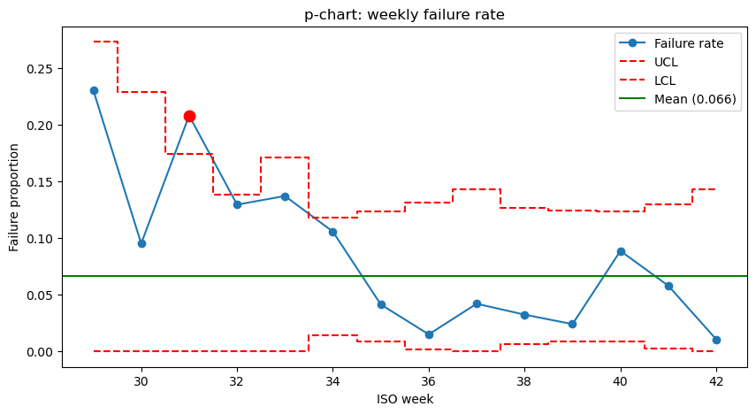
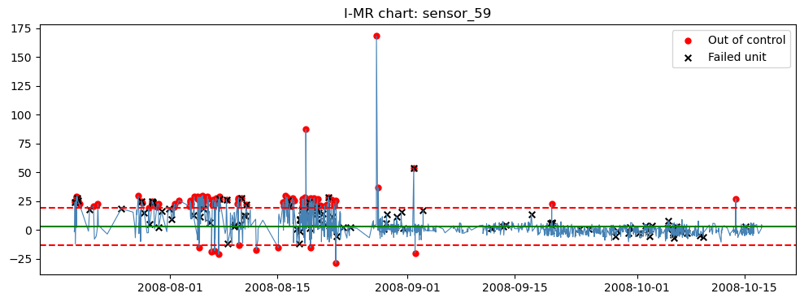
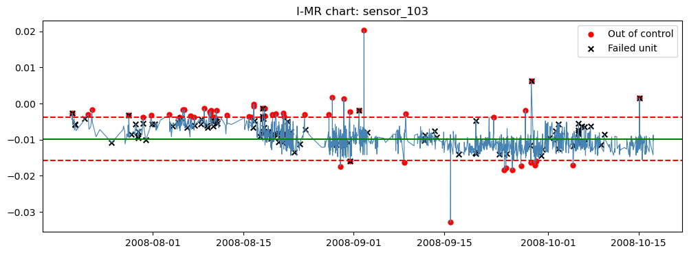
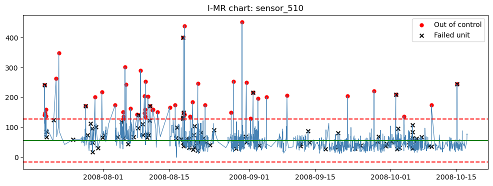

# Manufacturing Quality & Defect Analysis

> Can sensor data predict which semiconductor units will fail before they are
> tested? **Mostly no** — and the interesting part is how the analysis gets to
> that answer, and what is worth doing instead.


---

## Overview

1,567 production units from a semiconductor line, 590 anonymised sensor
readings each, and a pass/fail result. 104 units failed — **6.6%**.

The question a plant would actually ask: *when do failures happen, which
sensors are linked to them, and can we catch a bad unit before testing it?*

This project answers all three, and the honest answer to the third one is
**not reliably**. That conclusion is the deliverable, not a failed attempt at a
better one — because the way the analysis arrives at it is the part that
transfers to any other production dataset.

---

## The result that matters most

A Random Forest on these sensors looks usable under standard cross-validation
and falls apart once it has to predict the **future**:

| Validation method | ROC-AUC | PR-AUC | Baseline PR-AUC |
| --- | ---: | ---: | ---: |
| Shuffled 5-fold cross-validation | **0.716** | 0.151 | 0.066 |
| Train on first 70%, test on last 30% | **0.564** | 0.064 | 0.055 |
| Rolling validation, 5 windows, pooled | **0.566** | 0.087 | 0.050 |

Shuffled cross-validation lets the model train on units produced *after* the
ones it is scoring. A factory cannot do that. Re-run the same model so it only
ever learns from earlier units, and ROC-AUC drops from 0.716 to 0.564 — close
enough to 0.50 that it is barely better than guessing.

**Had this project stopped at the first row, it would have reported a working
model.** It does not work. The rolling validation confirms it: ROC-AUC stays
above 0.5 in all five windows (0.53–0.64), so there *is* a faint real signal,
but nothing a plant should act on.

Put into operational terms, on future data:

| Risk quintile | Failure rate |
| --- | ---: |
| Q1 (lowest) | 4.21% |
| Q2 | 5.36% |
| Q3 | 2.68% |
| Q4 | 5.36% |
| Q5 (highest) | **7.28%** |
| Overall | 5.0% |

The highest-risk group does carry the highest failure rate and holds 19 of the
65 failures (29%). But Q3 sits *below* Q1 — the ranking is not monotonic, which
is what you would expect from a weak signal rather than a real one.

---

## What does work: process monitoring



A p-chart tracks the weekly share of failed units against control limits that
move with each week's sample size. **Only week 31 breaches the upper limit** —
10 failures in 48 units (20.8%) against a limit of 17.4%.

The more useful pattern is the shape, not the single breach. Weeks 29–34 all sit
above the average failure rate; from week 35 onward the rate is mostly below it.
Something about the process changed around week 34–35. **The data does not say
what** — there is no machine, material or recipe column to check — but it is a
specific, dated question to take to the people who run the line, which is worth
more than a model with an AUC of 0.56.

### Shift makes no difference

| Shift | Units | Failure rate |
| --- | ---: | ---: |
| Morning (06–14) | — | 6.30% |
| Evening (14–22) | — | 7.04% |
| Night (22–06) | — | 6.51% |
| **Overall** | **1,567** | **6.64%** |

Chi-square **p = 0.88** — no evidence that shift affects failures. Note that
shift is **derived from the timestamp hour**, not recorded in the data, so this
tests an assumed schedule.

A negative result worth having: it rules out a common first hypothesis cheaply.

---

## Sensor analysis

Each of the 442 retained sensors was compared between failed and passed units
with a Mann-Whitney test, then the top sensors were put on I-MR control charts.



| Sensor | Out-of-control points | Failure rate when OOC | Lift vs 6.6% baseline |
| --- | ---: | ---: | ---: |
| `sensor_510` | 57 | **19.3%** | 2.9× |
| `sensor_103` | 56 | 14.3% | 2.2× |
| `sensor_59` | 130 | 13.8% | 2.1× |

When these sensors drift out of control, the failure rate is **two to three
times** the baseline. That sounds strong until you check coverage: **each one
catches only 8–17% of failures.** A combined rule using the top five flags about
a third of all units at a precision of 7.4% — barely above the 6.6% base rate.

So the sensors are real signals and bad detectors at the same time. Useful as
one input to an engineer's judgement; useless as an automatic screen.

<details>
<summary>I-MR charts for sensor_103 and sensor_510</summary>




</details>

### Anomaly detection

An Isolation Forest, which never sees the labels, scored **ROC-AUC 0.578** —
only slightly better than chance. It flagged 104 units; 14 were real failures.
Failed units do not simply look unusual in sensor space.

---

## Method

| Step | What was done |
| --- | --- |
| **Cleaning** | Dropped 32 sensors with >40% missing and 116 constant sensors → **442 retained**; remaining gaps median-filled |
| **Time features** | `date`, `hour`, `weekday`, ISO `week`, and an assumed `shift` |
| **Shift test** | Chi-square on the shift × outcome contingency table |
| **Process control** | Weekly p-chart with sample-size-dependent limits |
| **Sensor ranking** | Mann-Whitney U per sensor, with the Bonferroni cutoff (0.05/442 ≈ 0.000113) noted for multiple testing |
| **Sensor charts** | I-MR charts on the top 3, plus out-of-control precision, recall and lift for the top 10 |
| **Anomaly detection** | Isolation Forest, 300 trees, contamination set to the 6.6% base rate |
| **Prediction** | Random Forest, validated three ways — shuffled CV, one time split, and 5-window rolling |
| **Dashboard** | One Power BI page built from the exported Excel tables |

**The three-way validation is the methodological core.** Running only the first
would have produced a confident and wrong conclusion.

---

## The dashboard

One Power BI page reading `outputs/powerbi_tables.xlsx`:

| Element | Shows |
| --- | --- |
| Cards | Total units · failures · failure rate · weeks out of control · out-of-time ROC-AUC |
| Weekly p-chart | Failure rate with moving control limits, week 31 flagged |
| Column chart | Failure rate by shift, with the chi-square result annotated |
| Column chart | Risk quintiles on out-of-time data |
| Bar chart | Top sensor feature importances |
| Table | Per-sensor out-of-control points, failures caught, precision, recall and lift |
| Footer bar | Dashboard limitations, stated on the page itself |

The ROC-AUC card reads **≈ 0.57 · "Chance = 0.50 | Weak signal"**, and the
footer carries the caveats — 3 months of data, anonymised sensors, assumed shift
schedule, ~65 scored failures, no identified cause for the week 34–35 shift.
Putting the limitations on the dashboard rather than only in the notebook is
deliberate: it is the dashboard that gets forwarded.

Open `powerbi/manufacturing-quality-dashboard.pbix` in
[Power BI Desktop](https://powerbi.microsoft.com/desktop/) (free, Windows).

---

## Findings

1. **Shift does not affect failures.** 6.3% / 7.0% / 6.5%, chi-square p = 0.88.
   The shift hours are an assumption.
2. **One week is genuinely out of control** — week 31, 20.8% against a 17.4%
   limit — and the process appears to shift around week 34–35. Cause unknown
   from this data.
3. **A few sensors are linked to failures but detect them poorly.** 2–3× lift
   when out of control, 8–17% recall each, 7.4% precision for a combined rule.
4. **Anomaly detection is near chance.** ROC-AUC 0.578; 14 of 104 flagged units
   were real failures.
5. **The prediction model only looks good under easy testing.** 0.716 shuffled
   vs 0.564 out-of-time.
6. **On future data the gain is small.** Top-risk quintile 7.3% against 5.0%
   overall, holding 29% of failures, with a non-monotonic quintile pattern.

## Recommendations

- **Use control charts to monitor process stability**, and investigate what
  changed around week 34–35. That is the actionable finding here.
- **Do not rely on a predictive model to catch failures.** If one is deployed,
  validate it on later data — never shuffled — and retrain after any process
  change.

---

## Running it

```bash
git clone https://github.com/YOUR_GITHUB_USERNAME/manufacturing-quality-defect-analysis.git
cd manufacturing-quality-defect-analysis
pip install -r requirements.txt
jupyter notebook notebooks/manufacturing-quality-defect-analysis.ipynb
```

Kernel → Restart & Run All. The data is in `data/`, and the notebook writes
`outputs/powerbi_tables.xlsx`, which the dashboard reads.

> If Power BI shows a *file not found* error after cloning, go to
> **Transform data → Data source settings → Change source** and point it at
> `outputs/powerbi_tables.xlsx`. The path is absolute inside the `.pbix`.

---

## Project structure

```
manufacturing-quality-defect-analysis/
│
├── README.md
│
├── notebooks/
│   └── manufacturing-quality-defect-analysis.ipynb
│
├── data/
│   ├── secom.data              1,567 units × 590 sensors
│   ├── secom_labels.data       pass/fail + timestamp
│   ├── secom.names             original UCI description
│   └── data-dictionary.md      cleaning, derived features, what the data lacks
│
├── outputs/
│   └── powerbi_tables.xlsx     7 sheets — written by the notebook, read by Power BI
│
├── powerbi/
│   └── manufacturing-quality-dashboard.pbix
│
└── assets/
    ├── dashboard.png
    ├── weekly-p-chart.png
    └── imr-sensor-59.png · imr-sensor-103.png · imr-sensor-510.png
```

---

## Data

UCI **SECOM** — 1,567 units, 590 sensors, 104 failures, 19 July to 17 October
2008, 41,951 missing readings. Sensor names are anonymised. Full reference:
[data/data-dictionary.md](data/data-dictionary.md).

> McCann, M., & Johnston, A. (2008). *SECOM*. UCI Machine Learning Repository.
> https://doi.org/10.24432/C54305

---

## Limitations

- **Three months of data**, and roughly 65 failures in the out-of-time test, so
  single results are noisy.
- **Sensor names are anonymised**, so no failure can be given a physical cause.
- **The shift schedule is assumed** from the timestamp hour, not recorded.
- **The top sensors were selected using the failure labels**, so their reported
  performance is optimistic relative to genuinely new data.
- **Control limits use the full three months**, and the unstable early period
  widens them.

---

## Author

**Priyal Parmar**

[](https://linkedin.com/in/priyal-parmar-0b60a71b2)
[](https://github.com/priyalparmar-analytics)
[](mailto:priyalparmar1511@gmail.com)
